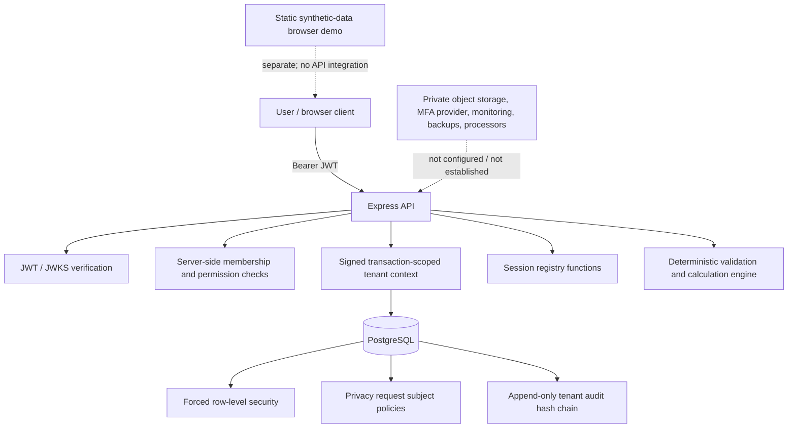

# ProfitPilot — Security, Trust & Privacy Overview

**Audience:** Prospective acquirers, technical diligence teams and authorised commercial reviewers  
**Revision:** 17 November 2026  
**Status:** Buyer-facing engineering overview of a development-stage prototype  
**Assurance boundary:** This document describes repository evidence and known limitations. It is not a security certification, penetration-test report, legal opinion, privacy compliance attestation or proof of production deployment.

## Executive summary

ProfitPilot has been developed with security and privacy controls as architectural requirements rather than deferred polish. The current repository includes JWT/JWKS authentication scaffolding, server-side tenant membership and permission checks, PostgreSQL row-level security (RLS), signed transaction-scoped tenant context, role-based permissions, session revocation primitives, a tamper-evident tenant audit chain and a privacy-request workflow.

The most important recent improvement is database-enforced privacy-request subject isolation. Ordinary members can read only their own privacy requests, while authorised tenant owners and administrators can review tenant requests. A member cannot insert a request for another member or update another member's request through the runtime database role. The latest verified CI run for this control set is run [#1046](https://github.com/luxhustle01-ux/Profitpilot/actions/runs/44002838128), which passed Node.js verification, unit tests, PostgreSQL migrations/RLS, authenticated API integration tests, production API image build and container health check.

A subsequent hardening change prevents an administrator from marking a privacy request fulfilled while no real export, correction, restriction or deletion executor exists. That change and the new inventory documentation are awaiting a fresh CI result as of this revision. Do not describe them as CI-verified until the corresponding run succeeds.

**Current maturity:** a partially implemented engineering foundation, not a production-ready service. No production deployment, live customer dataset, independent penetration test, security certification, completed privacy impact assessment or verified data-subject deletion lifecycle is established by the repository evidence reviewed for this document.

## 1. Implemented controls with repository evidence

### Identity and access
- API authentication is designed around JWT/JWKS verification and fails closed when required issuer, audience or JWKS configuration is absent.
- Token validation restricts accepted algorithms and validates required claims, token age and bounded token size.
- Tenant membership is resolved server-side from the verified identity; client-supplied tenant IDs are not treated as proof of membership.
- Granular permissions separate operations such as imports, matching, calculations, security administration and privacy administration.
- Sensitive operations use step-up claim checks. This middleware validates claims; it does not itself provide MFA. The identity provider must genuinely issue the required assurance claims after MFA/passkey verification.

### Tenant and database isolation
- A non-superuser runtime PostgreSQL role is configured without BYPASSRLS.
- Tenant context is signed and transaction-scoped. The runtime role cannot read the private tenant-context signing-key table.
- PostgreSQL RLS is enabled and forced for protected tables covered by the migrations.
- Integration tests cover cross-tenant denial, invalid or forged tenant context, membership checks and pooled-connection context cleanup.
- Privacy request access is further restricted by subject identity at the database layer in migration 012.

### Auditability and sessions
- Audit events are appended to a per-tenant hash chain. The API exposes chain verification and audit history to authorised roles.
- Runtime permissions prevent ordinary update/delete operations on audit events.
- Server-side session registry functions support listing and revoking a user's sessions.
- These are prototype controls; production monitoring, retention, independent tamper-resistance review and operational response are not established.

### Privacy request workflow
- Members can submit and view their own privacy requests.
- Authorised privacy administrators can review requests, verify identity, place/release legal holds, reject requests with a reason, and withdraw eligible requests through a constrained function.
- Database policies enforce subject-level read/insert/update boundaries.
- The API is being hardened to refuse a false “fulfilled” status until actual fulfilment operations exist.
- There is no implemented automated export, correction, restriction or deletion executor, and no verified backup-expiry/deletion propagation process.

## 2. Architecture overview

The following describes the current prototype boundary, not a deployed production topology.

## 3. Privacy and information handling

The current schema can hold identity and membership records, contract and site data, customer and supplier invoices, payroll allocation aggregates, arbitrary imported row payloads, matching decisions, calculations, audit events, permission overrides, privacy requests and session metadata.

Imported row payloads are stored as JSON in PostgreSQL. Such payloads may contain personal, payroll, commercial or financial information. The schema does not establish a secure binary upload service, private object storage or malware scanning pipeline.

A preliminary schema-derived inventory is maintained in [PRIVACY_DATA_INVENTORY.md](PRIVACY_DATA_INVENTORY.md). It is not yet reconciled against a production environment, all historical migrations, external processors, logs, backups or infrastructure.

No approved retention schedule or complete lifecycle implementation currently exists. A safe deletion design must account for legal holds, accounting/security retention, derived records, audit evidence, backups and downstream processors; blanket cascading deletion would be unsafe.

## 4. Verification evidence

The latest confirmed passing CI run at the time of the previous security milestone is [run #1046](https://github.com/luxhustle01-ux/Profitpilot/actions/runs/44002838128). It completed successfully and included:
- Node.js 22 syntax checks and unit tests;
- PostgreSQL schema and migration execution;
- tenant RLS verification under the restricted runtime role;
- authenticated API integration tests, including privacy subject isolation;
- production API container image build;
- running-container database health check.

Run #1046 predates the later change that rejects unsupported privacy fulfilment and the current buyer-pack documents. Those later changes require their own passing CI evidence.

CI is not a penetration test. It does not establish production security, exhaustive isolation coverage, legal compliance, availability, secure backups or resistance to a determined attacker.

## 5. Material limitations and residual risks

1. No production environment, API host, database instance or identity provider is configured.
2. The API rejects requests until production identity issuer, audience and JWKS settings are configured.
3. Step-up middleware checks token claims; genuine MFA/passkey enforcement and recovery depend on an unconfigured identity provider.
4. Production signing-key custody, rotation, recovery and operational access controls are not established.
5. No secure binary upload, private object storage, malware scanning or file retention/deletion pipeline is implemented.
6. Privacy requests are tracked but access exports, correction, restriction and deletion are not executed automatically.
7. No complete data inventory, approved retention schedule, privacy impact assessment, customer privacy notice or processor/cross-border register is established.
8. No backup restore test, incident-response exercise, production monitoring or service-level objective evidence is established.
9. Dependencies are declared with semver ranges; a committed lockfile and complete dependency/supply-chain assurance are still required.
10. No independent penetration test, remediation retest or security certification has been performed.
11. The browser demo uses synthetic data and is not connected to the API.
12. The product remains a partial API/database scaffold and validation specification, not a production application.

## 6. Acquisition diligence and handover

A prospective buyer should receive:
- repository and commit history;
- architecture, threat model and data inventory;
- control-to-test verification matrix;
- CI run links and test scope;
- explicit known-limitations and residual-risk register;
- dependency and deployment instructions;
- IP ownership and third-party licence review;
- a transfer plan for repository, domains, secrets, identity provider, infrastructure and customer data (if any).

A buyer should independently review the code, repeat the test suite, commission a penetration test and obtain qualified Australian privacy/legal advice before using real personal information or launching.

## 7. Current release position

**Prototype engineering foundation:** partially implemented.  
**Private customer pilot:** not approved by the current repository release gates.  
**Production deployment:** not ready.  
**Independent security assurance:** not performed.  
**Privacy fulfilment:** incomplete.

The commercial strength of this work is the documented engineering discipline and testable foundation—not a claim that ProfitPilot is already certified, compliant or production-secure.
