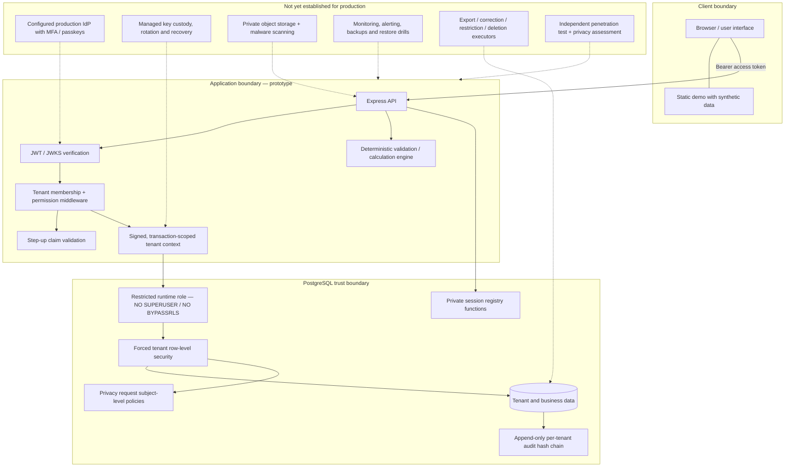

# ProfitPilot — Security Architecture Diagram

**Status:** Current prototype boundary as represented by the repository on 17 November 2026. Dashed nodes are required or future production components that are not established as configured services.

## Trust boundaries and interpretation

1. Client-supplied tenant IDs are selectors, not proof of access. The API resolves membership from the verified identity.
2. The API creates a signed tenant context for a transaction. PostgreSQL validates it and applies RLS under a restricted runtime role.
3. Privacy request RLS adds a subject-level boundary inside a tenant: members see their own requests; designated managers may review tenant requests.
4. Audit events are chained and append-only for runtime operations, but the chain is not independently anchored outside the database.
5. Dashed production components are gaps, not implied capabilities. In particular, the prototype does not yet execute data-subject exports or deletions and has no configured production identity provider or storage pipeline.
