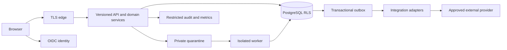

# System design and architecture decisions

## SD-01 — Runtime topology

Use a modular monolith with a responsive web client, versioned Express API, relational PostgreSQL database and a worker process from the same codebase when asynchronous work is needed. No requirement for native mobile or microservices. A production edge terminates TLS and applies request limits. A private database is accessible only to application and migration roles. An external OIDC provider issues short-lived tokens; the authenticated API signs transaction-local tenant context. Private storage and quarantined parser workers are proposed; the current bounded CSV receipts reside in PostgreSQL. A queue/outbox is a proposed extension, not present functionality.

Trust boundaries: browser input is untrusted; API verifies role and object; DB enforces tenant isolation and integrity; workers receive scoped, expiring jobs; external provider callbacks are independently authenticated and never treated as final settlement without reconciliation. No raw source data or secrets in telemetry, browser persistence or public repo.

## SD-02 — Bounded contexts and ownership

| Context | Owns | Public service responsibilities |
|---|---|---|
| IAM | identity reference, tenant, membership, role grants | token validation, membership checks, revocation |
| Master data | business/customer/site/contract/version/alias | version approval, lookup and ambiguity review |
| Source | batch, receipt, raw row, mapping, quarantine | permission reference, digest verification, replay, errors |
| Costing | payroll pool, allocation run/line, costs | reconciled decimal totals, reviewer decisions |
| Invoice | issuer, canonical invoice, evidence, lines, matching | identity conflicts, corrections, human review |
| Variation | request, approved scope/price, billing link | authorisation and reconciliation |
| Reporting | versioned calculation, exception, export, action | reproducible snapshots, safe exports |
| Transaction | quote, job acceptance, milestone, evidence | versioned agreement and participant-based access |
| Dispute | case, response, remedy, appeal | evidence, reviewer assignment and decision |
| Payment | provider intent/event, settlement, ledger | reconciled provider states; gated |
| Support/audit | event, notification, support session | redaction, correlation, access log |

Each domain owns writes to its records; other domains consume IDs or versioned read models. Use a same-tenant service transaction for related writes; no cross-domain direct mutation through UI. Provider calls occur outside DB transactions; outbox intent and idempotency key commit together. No synchronous network side effect in a financial database transaction.

## SD-03 — Architecture decisions

| ADR | Decision | Rationale / revisit trigger |
|---|---|---|
| ADR-001 | Modular monolith and Postgres | transactional integrity, simple transfer; split only for measured scaling or ownership need |
| ADR-002 | OIDC + signed tenant context + forced RLS | layered access; API key compromise remains critical residual risk |
| ADR-003 | Immutable evidence plus correction/restatement | reproduce historic outcome; controlled retention exceptions need audit |
| ADR-004 | Exact decimal or integer-minor-unit money | avoid rounding drift; currency scale checked and versions explicit |
| ADR-005 | Manual review for consequential transitions | confidence is not authority; no AI financial decisions |
| ADR-006 | Original digest and issuer authenticity separate | byte integrity alone does not establish issuer |
| ADR-007 | Provider adapter and double-entry subledger | no custody by default; provider review mandatory |
| ADR-008 | Synthetic fixtures and disabled live adapters | safe demonstration and transfer without customer data |
| ADR-009 | Transaction outbox + at-least-once delivery | retries safe via dedupe; never promise exactly-once network |
| ADR-010 | Schema migrations forward-only in normal deployment | roll back application only if compatible; otherwise restore or approved corrective migration |

## SD-04 — Deployment and change boundaries

Development uses synthetic data, local Compose and CI PostgreSQL. Staging uses isolated credentials and data. Production requires private networking, identity provider, storage, key custody, recovery, operational owner and G5/release approval. A buyer chooses hosting and provider after capacity/security review; no paid infrastructure assumed.

Version application, API, schema, formula, parser and report independently. Maintain backward-compatible API additions within v1; breaking changes require a version and migration notice. Use expand/backfill/validate/contract migrations with conflict inventory and backup. Never drop an identity constraint until its replacement is verified. Same-tenant composite foreign keys, unique constraints, locks and RLS remain the final integrity boundary. Document affected routes and migration rollback for each change.
